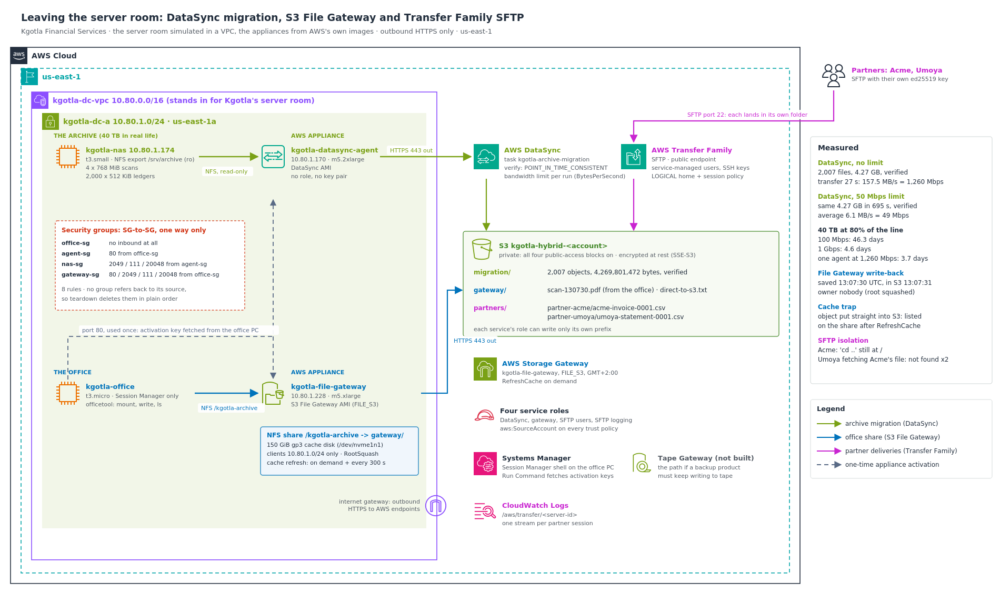

# Hybrid Storage and Data Transfer: DataSync, S3 File Gateway and Transfer Family, measured

Kgotla Financial Services, a Johannesburg payment processor, is leaving its server room. Three things still live there:

- **About 40 TB of archives on a NAS**: ten years of scanned documents and ledger exports. They have to move to S3 and be **verified**, without filling the office's 100 Mbps internet line during the working day, when it carries card authorisations and email.
- **A network drive that "goes to the backup tapes"**: staff save documents to a mounted share and won't change that habit. The files should end up in S3, not on tape.
- **An SFTP server under a desk** that partners use to deliver files. It has one shared login, so every partner can see every other partner's files, and nobody patches it.

The board also asked one question I had to answer with numbers: **"How long will 40 TB take, and do we need to ship disks instead?"**

I rebuilt Kgotla's server room as a VPC. It has a Linux NAS holding a sample of the archive, an office PC, and the two AWS appliances deployed exactly as Kgotla would run them on-premises: a **DataSync agent** and an **S3 File Gateway**, both from AWS's own images and talking to AWS only over outbound HTTPS. Then I migrated the archive, gave the office its share, replaced the SFTP server, and measured each one.

**Headline results**

| | Result | What it proves |
|---|---|---|
| **DataSync, no limit** | 2,007 files, **4.27 GB** in a **27 s** transfer phase: **157.5 MB/s = 1,260 Mbps**, then verified (SUCCESS) | One agent can move data faster than Kgotla's whole office line, and every file is checked at both ends |
| **DataSync, limited to 50 Mbps** | Same 4.27 GB in **695 s**: average **6.1 MB/s = 49 Mbps**, verified | A bandwidth limit keeps the migration inside the share of the line the business can spare |
| **The board's question: 40 TB** | 100 Mbps line at 80%: **46.3 days**. 1 Gbps at 80%: **4.6 days**. One agent at my measured rate, at 80%: **3.7 days** | On today's line, the link is the problem, not the tool. The decision is a link upgrade or offline transfer, with numbers behind it |
| **File Gateway write-back** | Saved on the office PC at **13:07:30 UTC**, in S3 at **13:07:31 UTC** (about **1 s**) | The office keeps its mounted drive; the file is an ordinary S3 object a second later |
| **The cache trap** | An object put straight into S3 was listed on the share after `RefreshCache` (I didn't capture the listing before the refresh); auto-refresh then set to **300 s** | A gateway's view of the bucket is a cache, so I configured both on-demand and timed refresh |
| **SFTP isolation** | Acme's `cd ..` left it at `/`; Umoya's two attempts to fetch Acme's invoice both returned **not found** | Each partner's `/` is its own folder, enforced twice: logical home directory and session policy |

- **Nothing in the "server room" accepts a connection from outside.** The appliances reach AWS over outbound HTTPS only. Port 80 was open only from the office PC's security group and used only for the one-time activation, which I ran from inside the network through SSM Run Command (in production I'd remove that rule once both appliances are activated). Every security-group rule is SG-to-SG and points one way.
- **Every service role is limited to its own S3 prefix** (`migration/`, `gateway/`, `partners/`), and every service trust policy carries `aws:SourceAccount`.
- Built, measured and torn down the same day, with a clean check that came back empty.



---

## The problem I was solving

> Move the archive online, measured and verified, with a bandwidth plan the business can live with. Give the office a file share that lands in S3. Replace the desk-side SFTP server with a managed one where each partner sees only their own folder. Answer "online or offline?" with arithmetic, not opinion.

This continues work for the same client: `aws-cloudtrail-config-governance` gave Kgotla an audit trail, and `aws-shared-file-storage` moved its back office onto FSx for Windows with AD permissions. This project deals with what is still physically in the building. The server room is simulated in a VPC, the same approach as `aws-site-to-site-vpn-hybrid`.

---

## Four ideas the whole build depends on

1. **DataSync moves data; Storage Gateway gives ongoing access to it.** DataSync is for copying a data set (once, or on a schedule) and verifying it. Storage Gateway is for on-premises applications that keep using a local NFS or SMB share while the data lives in AWS.
2. **Both need an appliance inside the building.** It's a VM (here, an EC2 instance from AWS's image) that reads the local storage and talks to AWS over HTTPS. It's **activated** once: something on the local network asks it for a key on port 80, and that key registers it with your account.
3. **The network is the limit, not the tool.** 40 TB is 320 terabits. At 100 Mbps that's 37 days with nothing else on the line. That arithmetic decides between a bandwidth limit plus patience, a faster link, or offline transfer.
4. **Transfer Family is a managed SFTP front door to S3.** Each user gets a role, a **logical home directory** (their `/` is a folder in the bucket) and an optional **session policy** that narrows the role further for that user. There's no server to patch.

---

## Architecture decisions

| Requirement | Decision | Why |
|---|---|---|
| Move the archive once, verified | **DataSync** task, NFS location → S3 location, `VerifyMode=POINT_IN_TIME_CONSISTENT` | Copies, then re-reads both sides and compares every file |
| Don't fill the office line in working hours | **DataSync bandwidth limit** (`BytesPerSecond`) per run | Measured at 49 Mbps against a 50 Mbps limit |
| Office keeps its "network drive", data in S3 | **S3 File Gateway** NFS share on the `gateway/` prefix, 150 GiB local cache | Files become normal S3 objects; recent files are served from the cache |
| Office habit was tape, but no backup software writes to it | **File Gateway, not Tape Gateway** (Tape documented, not built) | Tape Gateway is for backup products that must keep writing to tape |
| Only the office may mount the share; root on a client isn't root on the share | **Client list `10.80.1.0/24`** and **RootSquash** | A file root saved shows up as `nobody` |
| Objects written straight into S3 must show up on the share | **`RefreshCache`** on demand, plus **`CacheStaleTimeoutInSeconds=300`** | The gateway refreshes a folder's listing when its cached view is older than 5 minutes |
| Partners keep using SFTP | **Transfer Family**, SFTP, service-managed users with ed25519 keys | Same client tools; no server to run |
| Partner A never sees partner B | **Logical home directory** per user **and** a **session policy** scoped with `${transfer:UserName}` | Two independent locks; either one alone would stop it |
| Every SFTP session on record | **Logging role** with `AWSTransferLoggingAccess` | One CloudWatch Logs stream per session |
| No service can be used by another account | A role per service, **`aws:SourceAccount`** on every trust policy | AWS's recommended protection against the confused-deputy problem |
| Appliances never exposed | Port 80 **only from the office PC's SG**, used only for activation (remove the rule afterwards in production); no instance role, no key pair on the appliances | They authenticate to AWS through activation, not through EC2 |
| Teardown can't deadlock | Every SG rule points one way (no group refers back to its source) | Groups delete in plain order |

Long-form reasoning is in [`docs/adr/`](docs/adr). The diagram uses the **official AWS Architecture Icons** and is generated from [`docs/diagram/build_architecture.py`](docs/diagram/build_architecture.py). The icon pack itself isn't committed: AWS licenses it for diagrams, not redistribution.

---

## How I measured it

| Tool | What it does |
|---|---|
| [`nas/userdata.sh`](nas/userdata.sh) | Builds the archive sample at boot: 4 × 768 MiB "scans" and 2,000 × 512 KiB "ledgers" of random data (4,269,801,472 bytes, so nothing compresses in transit), exported read-only over NFS to the VPC range |
| [`scripts/activation_key.py`](scripts/activation_key.py) | Uses SSM Run Command to run `curl` **on the office PC** against an appliance's private IP and prints only the activation key, retrying while the appliance boots |
| [`scripts/datasync_run.py`](scripts/datasync_run.py) | Starts the task (optionally with a limit in Mbps), prints the phase and the rate every ~10 s, then the result: files, bytes, prepare / transfer / verify times, rate, verification status. Appends a CSV row |
| [`scripts/transfer_calc.py`](scripts/transfer_calc.py) | Days to move N TB over each link at 100% and at the share the business can spare, plus a row for a measured rate |
| [`office/officetool.py`](office/officetool.py) | On the office PC: finds the gateway and share through the instance role, mounts it, writes a 5 MiB "scan" (with `fsync`) and prints the UTC time, lists the share |
| [`scripts/wait_s3.py`](scripts/wait_s3.py) | Watches an S3 prefix and reports the first new object: its `LastModified` time, size and the metadata the gateway attached |
| [`sftp/*.txt`](sftp) | SFTP batch files for each partner, including the escape and cross-partner attempts |

The calculator took my full-speed figure straight from the results CSV, so no number was retyped: `--measured-mbps "$(awk -F, '$1=="full-speed"{print $NF}' build/datasync-results.csv)"`.

---

## What I proved

| Test | Result | Evidence |
|---|---|---|
| "Server room" network | ✅ VPC, subnet, internet gateway and route table created; default route `True`; route table `associated` | [`01`](docs/screenshots/01-step1-vpc-subnet-gateway-route.png) |
| Security groups | ✅ 4 groups, **8 rules**, all SG-to-SG, one way | [`02`](docs/screenshots/02-step1-four-sgs-eight-rules.png) |
| Private bucket, least-privilege roles | ✅ All four public-access blocks `True`; 7 policies rendered; 4 service roles + office role and profile | [`03`](docs/screenshots/03-step2-private-bucket-and-policy-renders.png)–[`05`](docs/screenshots/05-step2-office-role-and-profile.png) |
| Appliances from AWS's own images | ✅ DataSync AMI and S3 File Gateway AMI from public SSM parameters; office boot script 2,370 bytes | [`06`](docs/screenshots/06-step3-appliance-amis-and-userdata.png)–[`08`](docs/screenshots/08-step3-private-ips.png) |
| **Agent activated from inside the network** | ✅ Key returned to the office PC after 7 s; agent `ONLINE`, endpoint `PUBLIC` | [`09`](docs/screenshots/09-step4-agent-activated-online.png) |
| Migration task | ✅ NFS source `/srv/archive`, S3 destination `/migration`, `POINT_IN_TIME_CONSISTENT` | [`10`](docs/screenshots/10-step5-locations-and-verified-task.png) |
| **Full-speed run** | ✅ 2,007 files, 4.27 GB; prepare 2 s, transfer 27 s, verify 10 s; **157.5 MB/s = 1,260 Mbps**; **SUCCESS**. S3: 2,007 objects, 4,269,801,472 bytes | [`11`](docs/screenshots/11-step5-full-speed-run-live.png), [`12`](docs/screenshots/12-step5-full-speed-result-and-s3.png) |
| **Run limited to 50 Mbps** | ✅ Transfer 695 s, **6.1 MB/s = 49 Mbps** average, **SUCCESS** | [`13`](docs/screenshots/13-step6-throttled-run-50-mbps.png), [`15`](docs/screenshots/15-step6-throttled-run-result.png) |
| Raising the limit mid-run | ⚠️ `update-task-execution` to 200 Mbps returned no error, but the rate never rose (see below) | [`14`](docs/screenshots/14-step6-update-task-execution.png), [`15`](docs/screenshots/15-step6-throttled-run-result.png) |
| **40 TB answer** | ✅ 37.0 / 46.3 days at 100 Mbps; 3.7 / 4.6 days at 1 Gbps; 2.9 / 3.7 days at 1,260 Mbps (100% / 80%) | [`16`](docs/screenshots/16-step7-transfer-calculator-and-csv.png) |
| Gateway activated with a cache | ✅ Key after 7 s; `/dev/nvme1n1` added as cache; `RUNNING`, `FILE_S3`, `EC2`, 10.80.1.228 | [`17`](docs/screenshots/17-step8-gateway-activated-cache-added.png) |
| Share locked to the office | ✅ `/kgotla-archive` → `s3://…/gateway/`, clients `10.80.1.0/24`, `RootSquash`, `AVAILABLE` | [`18`](docs/screenshots/18-step8-nfs-share-available.png) |
| **Office saves a file** | ✅ Mounted over NFS; `scan-130730.pdf` (5 MiB) written 13:07:30 UTC; S3 `LastModified` 13:07:31 UTC; gateway metadata on the object (owner and group 65534, mode 0644, file times) | [`19`](docs/screenshots/19-step9-office-mounts-share.png)–[`22`](docs/screenshots/22-step9-share-shows-scan-root-squashed.png) |
| **Cache trap and fix** | ✅ `direct-to-s3.txt` uploaded straight to S3; after `RefreshCache` the office lists it; `CacheStaleTimeoutInSeconds = 300` | [`23`](docs/screenshots/23-step9-direct-upload-refresh-cache-auto-refresh.png)–[`25`](docs/screenshots/25-step9-cache-stale-timeout-300.png) |
| Managed SFTP | ✅ Server `ONLINE`; one ed25519 key pair per partner (private keys stay on my machine); 2 users, `LOGICAL`, 1 key each | [`26`](docs/screenshots/26-step10-sftp-server-and-partner-keys.png), [`27`](docs/screenshots/27-step10-two-logical-users.png) |
| **Acme can't climb out** | ✅ Uploaded its invoice (38 bytes); `cd ..` then `pwd` → `/`; listing shows only its own file | [`28`](docs/screenshots/28-step11-partner-test-files.png), [`29`](docs/screenshots/29-step11-acme-session-jailed.png) |
| **Umoya can't read Acme** | ✅ Uploaded its statement (39 bytes); `get` by name and by full bucket path: both **not found**. S3 shows each file under its own prefix | [`30`](docs/screenshots/30-step11-umoya-denied-and-s3-prefixes.png) |
| Every session logged | ✅ One CloudWatch Logs stream per partner session | [`31`](docs/screenshots/31-step11-sftp-log-streams.png) |
| Teardown | ✅ Share and gateway deleted, 4 instances shutting down; every clean-check query empty | [`32`](docs/screenshots/32-step12-teardown-services-and-instances.png), [`33`](docs/screenshots/33-step12-clean-check.png) |

Walkthroughs: [`docs/datasync-migration.md`](docs/datasync-migration.md), [`docs/transfer-math.md`](docs/transfer-math.md), [`docs/file-gateway.md`](docs/file-gateway.md), [`docs/partner-sftp.md`](docs/partner-sftp.md).

### What I didn't prove, and why I'm saying so

- **The mid-run limit change.** I raised the limit from 50 to 200 Mbps with `update-task-execution` while the transfer was running. The command returned without an error, but the interval rates stayed in the same band (mostly 62–66 Mbps) from the start of the transfer to the end, and the whole run averaged 49 Mbps. I didn't check `describe-task-execution` for the stored `BytesPerSecond` straight after the update, so I can't say whether the change was never applied or applied without effect. That's the first thing I'd check next time, before telling a client "you can open it up after hours".
- **The "invisible" moment of the cache trap.** My screenshots show the share before the direct upload (only the scan) and after `RefreshCache` (both files). I didn't capture a listing between the upload and the refresh.
- **Interval rates above the limit.** Some 10-second intervals in the limited run show ~63 Mbps and others 0.0. DataSync's byte counter updates in steps, so short intervals are noisy; the average over the 695 s transfer (49 Mbps) is the number that matters, and it's inside the limit.

---

## Which tool, when

| Situation | Use | Not |
|---|---|---|
| Copy a data set to AWS once or on a schedule, verified, with a bandwidth limit | **DataSync** | Scripts with `aws s3 sync` (no verification report, no managed agent, no limit per run) |
| On-premises apps keep saving to an NFS/SMB share, but the data should live in S3 | **S3 File Gateway** | DataSync on a schedule (users would see stale copies) |
| Backup software that writes to tape | **Tape Gateway** (virtual tape library → S3 / Glacier) | File Gateway (the backup product can't write to it as tape) |
| Block storage over iSCSI for on-premises servers | **Volume Gateway** (cached or stored) | File Gateway |
| Partners deliver files over SFTP/FTPS/AS2 | **Transfer Family** | An EC2 SFTP server (patching, shared logins) |
| Tens of TB on a slow line, needed in days | **Offline transfer** or a faster link | Online transfer alone (46 days for 40 TB at 80% of a 100 Mbps line) |

On offline transfer: AWS Snowball Edge is no longer available to new customers. AWS now points to **AWS Data Transfer Terminals** (bring your own storage to an AWS-run location) and partner services, so I priced those, not a Snowball.

---

## Debugging along the way

- **The gateway's NFS share needs port 20048 as well as 2049 and 111.** NFSv3 mounts go through `mountd`, which AWS's File Gateway listens for on 20048. I included it from the start on both the NAS and the gateway groups.
- **A share on a prefix needs a trailing slash and a name.** `--location-arn arn:aws:s3:::bucket/gateway/` only works with `--file-share-name`; the share path became `/kgotla-archive`.
- **No security group refers back to its source.** In the shared-storage build, two groups that referenced each other blocked each other's deletion. Here every rule points one way (office → agent and gateway, agent → NAS), so the groups deleted in plain order.
- **LAUNCHING takes about 90 seconds.** Both DataSync runs spent about 1.5 minutes in `LAUNCHING` before any data moved. That's DataSync starting up the run, not a fault. Over a 40 TB migration that fixed start-up time is noise, so the calculator uses the transfer-phase rate.
- **The calculator reads the measured rate from the CSV.** Instead of retyping 1,260, I passed the last column of the `full-speed` row with `awk`, so the table and the CSV can't disagree.
- **The usual rules held:** `sudo` for `cloud-init status` on the office PC, single quotes for every query with a `!` or backticks, and one chained line (`cd … && source ./env.sh && aws ssm start-session …`) for the office terminal.

Full notes: [`docs/debugging-journey.md`](docs/debugging-journey.md).

---

## Cost

Three pieces bill **by the hour while they exist**, so I built, measured and tore down in one sitting.

| Item | Rate (us-east-1 list price, approx.) | This build |
|---|---|---|
| DataSync agent on m5.2xlarge (the size AWS recommends for an agent) | ~US$0.38/hour | ~2.5 hours |
| File Gateway on m5.xlarge + 150 GiB gp3 cache | ~US$0.21/hour | ~2 hours |
| Transfer Family SFTP endpoint | US$0.30/hour + US$0.04/GB transferred | ~1 hour |
| NAS (t3.small) + office PC (t3.micro) | ~US$0.03/hour together | ~2.5 hours |
| DataSync data copied | US$0.0125/GB | ~8.5 GB (two runs) ≈ US$0.11 |
| S3, CloudWatch Logs, Storage Gateway service | per GB / per request | cents |
| **Total (estimate)** | | **about US$2–4** |

At Kgotla's real size the per-GB DataSync charge dominates: 40 TB × US$0.0125 ≈ **US$500** once, against weeks of a busy office line. Cost Explorer for 5–6 October ([`34`](docs/screenshots/34-cost-explorer-oct-5-6.png)) showed US$3.53 for the whole account, of which about US$2.04 was everything except always-on Config and Security Hub: mainly this and the two other builds I ran on 5 October. Details: [`docs/cost-model.md`](docs/cost-model.md).

---

## Compliance & frameworks

Kgotla's archive holds payment records and customer documents, so the transfer itself is in scope, not just where the data ends up.

- **POPIA §19 (South Africa)**: appropriate technical measures for personal information. TLS in transit from every appliance and SFTP session, encrypted at rest in S3, access limited by role and prefix.
- **PCI DSS v4.0** (Kgotla is a payment processor)
  - **Req 4.2**: strong cryptography in transit for cardholder data over open networks. Appliances use HTTPS; partners use SFTP.
  - **Req 7.2**: access by business need. Each partner reaches only its own folder; each service role only its own prefix.
  - **Req 8.2**: unique IDs and no shared accounts. One user and one SSH key per partner instead of a shared login.
  - **Req 10.2**: audit logs of access. One CloudWatch Logs stream per SFTP session.
- **ISO/IEC 27001:2022 Annex A**
  - **A.5.14 Information transfer**: defined, controlled transfer paths for the archive, the office share and partner deliveries.
  - **A.5.15 Access control** and **A.8.3 Information access restriction**: logical home directories, session policies, prefix-scoped roles.
  - **A.8.15 Logging**: SFTP session logs.
  - **A.8.20 Networks security**: no inbound access from outside; SG-to-SG rules only.
  - **A.8.24 Use of cryptography**: HTTPS and SFTP in transit, SSE-S3 (S3's default encryption) at rest.
- **NIST SP 800-53 Rev. 5**
  - **AC-3** access enforcement and **AC-6** least privilege (role per service, session policy per user).
  - **AU-2 / AU-12**: event logging for partner sessions.
  - **SC-8** transmission confidentiality and integrity, **SC-28** protection at rest.
  - **SI-7** integrity: DataSync's verification compares every file at both ends.
- **NIST Cybersecurity Framework 2.0**
  - **PR.AA-05**: least-privilege access.
  - **PR.DS-01 / PR.DS-02**: data at rest and in transit protected.
  - **DE.CM-03**: personnel and partner activity monitored through session logs.
- **SOC 2 (AICPA Trust Services Criteria)**: **CC6.1** logical access, **CC6.7** protection of data in transmission.

---

## Repo layout

```
.
├── README.md
├── env.sh.example                    # copy to env.sh (git-ignored); saved IDs + the save() helper
├── nas/
│   └── userdata.sh                   # the "on-premises" NAS: builds the archive sample, exports it over NFS
├── office/
│   ├── officetool.py                 # office PC: mount the gateway share, write a test scan, list
│   └── userdata.sh.tpl               # office PC boot script (officetool embedded at build time)
├── scripts/
│   ├── build_userdata.py             # embeds officetool (gzip + base64), checks the 16 KB limit
│   ├── activation_key.py             # appliance activation key from inside the network, via SSM
│   ├── datasync_run.py               # runs the task, shows the live rate, records the result
│   ├── transfer_calc.py              # how long N TB takes over a given link
│   ├── wait_s3.py                    # reports the first new object under a prefix + its metadata
│   ├── render.py                     # fills @@NAME@@ placeholders; refuses to leave any empty
│   └── kit_aws.py                    # shared helper (repo-relative paths)
├── policies/                         # trust policies (aws:SourceAccount) and prefix-scoped roles
├── sftp/
│   ├── acme-batch.txt                # upload, then try to climb out
│   └── umoya-batch.txt               # upload, then try to fetch Acme's file two ways
└── docs/
    ├── architecture.png / .svg       # official AWS Architecture Icons
    ├── diagram/                      # build_architecture.py + awsdiag.py
    ├── datasync-migration.md
    ├── transfer-math.md
    ├── file-gateway.md
    ├── partner-sftp.md
    ├── debugging-journey.md
    ├── cost-model.md
    ├── teardown.md
    ├── adr/                          # 6 architecture decision records
    └── screenshots/                  # 34 build, test, teardown and cost screenshots, in order
```

> **No account IDs are committed.** Templates use `@@NAME@@` placeholders filled at run time, and account IDs are masked in the screenshots. There is no `Deny` statement anywhere, and nothing has deletion protection, so teardown can't lock anyone out.

---

## Reproduce it

From WSL, in `us-east-1`, as an administrator. The DataSync agent, gateway and SFTP endpoint bill by the hour, so plan for one sitting of about 2.5 hours.

1. From the repo folder: `cp env.sh.example env.sh && mkdir -p build && source ./env.sh`. Save `ACCOUNT_ID` and `BUCKET` (`kgotla-hybrid-<account>`), and check that m5.2xlarge, m5.xlarge, t3.small and t3.micro are offered in your AZ.
2. VPC `10.80.0.0/16` (DNS hostnames on), one subnet, an internet gateway and a default route. Four security groups: office (no inbound); agent (80 from office); NAS (2049, 111, 20048 from agent); gateway (80, 2049, 111, 20048 from office).
3. Create the bucket, render the policies with `scripts/render.py`, and create the DataSync, gateway, SFTP-user and SFTP-logging roles plus the office role and instance profile.
4. `python3 scripts/build_userdata.py`, then launch the NAS (AL2023, `nas/userdata.sh`) and the office PC (AL2023, `build/office-userdata.sh`), both with the office instance profile for Session Manager, the agent (`/aws/service/datasync/ami`, m5.2xlarge) and the gateway (`/aws/service/storagegateway/ami/FILE_S3/latest`, m5.xlarge, extra 150 GiB gp3 disk). IMDSv2 on the Linux instances; no key pairs anywhere.
5. `python3 scripts/activation_key.py "$OFFICE_ID" "$AGENT_IP" sync`, then `aws datasync create-agent`. Create the NFS and S3 locations and the task with `VerifyMode=POINT_IN_TIME_CONSISTENT`.
6. `python3 scripts/datasync_run.py full-speed`, then `python3 scripts/datasync_run.py business-hours-then-night --all --mbps 50`.
7. `python3 scripts/transfer_calc.py --tb 40 --links 100,1000 --util 0.8 --measured-mbps <full-speed Mbps from build/datasync-results.csv>`.
8. `activation_key.py … gateway`, `aws storagegateway activate-gateway` (`FILE_S3`), `add-cache` with the free disk, then `create-nfs-file-share` on `s3://$BUCKET/gateway/` with `--file-share-name`, client list `10.80.1.0/24` and `RootSquash`.
9. On the office PC (Session Manager): `officetool mount`; run `python3 scripts/wait_s3.py gateway/` locally and `officetool write` on the office PC. Upload an object straight to `gateway/`, list the share, `refresh-cache`, list again; set `CacheStaleTimeoutInSeconds=300`.
10. `aws transfer create-server` (SFTP, service-managed, logging role); an ed25519 key pair per partner; `create-user` with a `LOGICAL` home directory and `policies/partner-session-policy.json.tpl` as the session policy. Run both `sftp -b` batches and list `partners/` in S3.
11. Teardown the same day: [`docs/teardown.md`](docs/teardown.md).

---

## What this connects to

- `aws-site-to-site-vpn-hybrid`: in production, the appliances would reach AWS over the VPN or Direct Connect, with DataSync using a VPC endpoint instead of the public one.
- `aws-shared-file-storage`: Kgotla's back office already runs on FSx for Windows. The same DataSync agent can copy old Windows shares straight into it over SMB.
- `aws-backup-archival-tested-restore`: once the archive is in S3, lifecycle rules can move ten-year-old scans to Glacier tiers, and backups need a tested restore.
- `aws-private-connectivity-endpoints`: a VPC-hosted SFTP endpoint with an IP allow-list and private DataSync endpoints would take this off the public internet.
- `aws-cloudtrail-config-governance`: every activation, task run and user change here is a CloudTrail event in Kgotla's audit trail.
